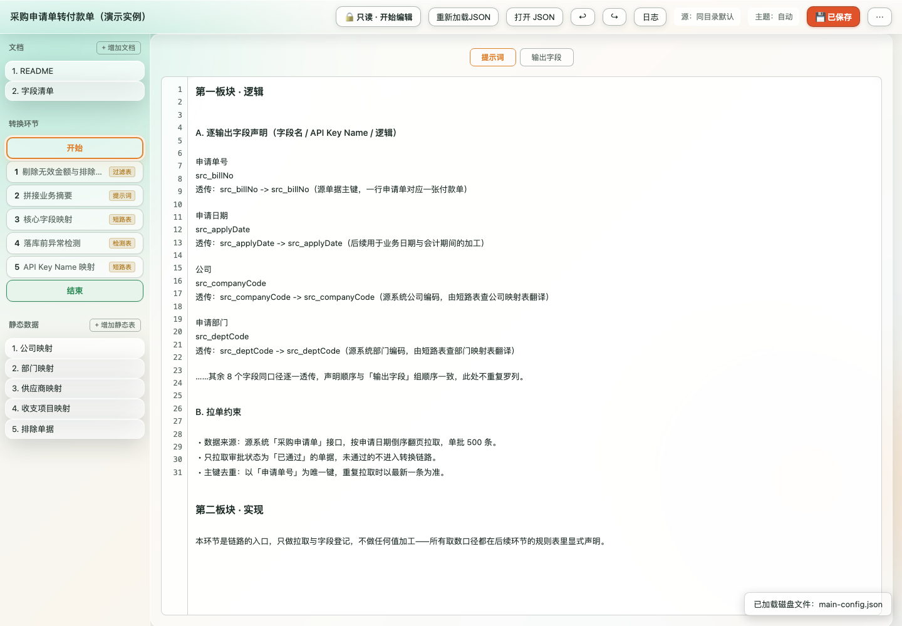
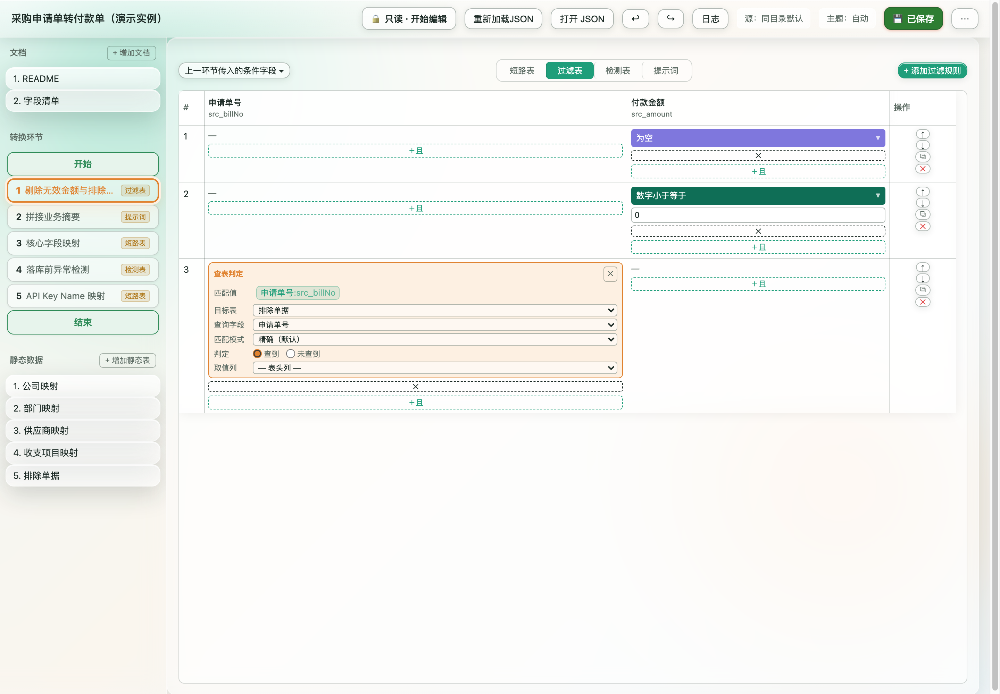

# 规则链编辑器（RuleChain Editor）

一个把「异构系统之间的单据转换规则」做成可视化配置的单文件 Web 编辑器。

业务背景很朴素：两个系统要对接单据，中间的字段映射、编码翻译、条件分流、异常检测，
传统做法是写死在代码里——改一条规则就要改代码、发版、回归测试。
本工具把这套逻辑抽成一份 JSON 配置，用表格化的界面来编辑，改规则不用碰代码。

**四种环节模式**是这个工具的核心设计：短路表、过滤表、检测表、提示词。
每种只干一件事，禁止互相内嵌——这条「模式纯度」约束贯穿整个实现。

> 内置演示配置是一个虚构的「采购申请单 → 付款单」转换链路，覆盖四种模式与四张映射表。
> 所有公司、部门、供应商、单号均为虚构示例数据。

---

## 快速运行

需要 Python 3（仅用标准库，无第三方依赖）和任意现代浏览器。

```bash
cd 规则链编辑器_技术演示版
python3 server.py 8000
```

浏览器打开 <http://127.0.0.1:8000/RuleChainEditor.html>

`server.py` 提供静态托管 + JSON 写回 + 覆盖前自动备份。也可以直接用 Edge 打开
`RuleChainEditor.html`（`file://` 协议下写回走浏览器文件句柄；Chrome / Safari 受 CORS 限制，不推荐）。

界面右下角可切换浅色 / 深色 / 自动主题。

---

## 从界面看设计

打开后默认就是演示配置，左侧是环节链，中间是当前环节的规则面板，左栏下方是静态映射表。



### 短路表：判断 + 映射，命中即短路

一个输出字段对应一条**规则链**，从上往下逐条判定，**第一条命中的规则立即取值，不再往下看**。
每个输出字段一个选项卡，规则、条件、输出一目了然：


### 短路表：判断 + 映射，命中即短路

一个输出字段对应一条**规则链**，从上往下逐条判定，**第一条命中的规则立即取值，不再往下看**。

以演示配置的「单据类型」为例：

| 条件 | 输出 |
| --- | --- |
| 费用类型 包含「服务」 | 常量 `2` |
| （无条件，通配） | 常量 `1` |

三条硬约束：

1. **通配只能居末位**——无条件规则必然命中，它后面再写规则就是死代码。
2. **未命中默认空**——全链不命中就不写值，绝不加兜底造值规则；宁可下游报错，也不静默填假值。
3. **不做拦截**——短路表只产出值，`跳过 / 报异常 / 停止` 这类动作在短路表里连下拉选项都不给。

输出类型只有三类：常量、变量、查表。变量支持加工，比如 `[申请日期]-1`（按天偏移）、
`[申请日期]yyyyMM`（格式化）、`[付款金额]*0.06`（数字运算），或用文本模板混排多个字段。

### 过滤表：行内 AND，行间 OR

规则之间是「或」——任一行命中就弃行；同一行的多个条件之间是「且」。
演示配置用它剔除金额为空、金额 ≤ 0、以及命中排除名单的单据。



### 检测表：只报告，不改数据

逐条独立判定，可以多条同时命中，命中只记一条异常说明，**不弃行也不拦行**。
演示配置用它检查「供应商未映射」「部门未映射」「金额超 50 万」「大额服务类付款」四类问题，
异常清单交给人工订正，避免脏数据落库。


### 提示词：表达不了的就整环节交给它

需要文本拼接、逐行展开、按比例拆分金额这类复合逻辑时，短路表 / 过滤表 / 检测表都表达不了。
这时候整环节用提示词实现，而不是把它们硬塞进表里。

---

## 两个值得说的工程约束

### 环节链字段契约

每个环节的**输入字段必须完全等于**上一个环节的输出字段。上游没声明的字段，下游取不到——
引擎虽然机械上能全行透传，但那只是实现副作用，不能当契约用。

这条约束的好处是：打开编辑器就能看出依赖关系。要用的字段上游没输出，就是契约断裂，
必须补一条显式透传规则，而不是靠「反正数据在行里」蒙混过去。

编辑器会对违规引用标红：引用了本环节输入字段之外的变量，输入框内直接红底提示。

### 模式纯度铁律

四种模式各自纯粹独立，禁止互相嵌套规则。想拦截就单开一个过滤环节，想检测就单开一个检测环节。

这不是洁癖。短路表是「首中即止」逐字段推值的，一旦把拦截动作塞进某个字段的第 N 条规则，
检测逻辑就被藏进映射链深处——谁拦的、拦了谁、还差哪几条，一眼看不全。

宁可多拆一个环节，也不让一个环节兼任两种职责。

---

## JSON 结构

配置是一份 JSON，四个顶层部分：

```jsonc
{
  "schemaVersion": "V2",
  "编辑器版本号": "V5",
  "标题": "采购申请单转付款单（演示实例）",
  "文档":     [ /* 配置内自带说明文档 */ ],
  "文件":     { /* 输入输出文件与目标表列定义 */ },
  "元信息":   { /* 名称、生成时间、行语义约定 */ },
  "静态数据": {
    "公司映射": { "表头": ["源系统编码","源系统名称","","目标系统编码","目标系统名称"],
                  "行": [["HQ","总部","","100","总部"]] }
  },
  "转换逻辑": {
    "阶段0_开始": { "模式": "提示词", "输入字段": [...], "输出字段": {...} },
    "环节3":     { "模式": "短路表", "输入字段": [...], "输出字段": {
                     "单据类型": {
                       "规则": [
                         { "条件": [{ "字段":"费用类型", "算子":"包含", "值":"服务" }],
                           "输出": { "类型":"常量", "值":"2" } },
                         { "条件": [], "输出": { "类型":"常量", "值":"1" } }
                       ],
                       "api_key_name": "bill_type"
                     }
                   } }
  }
}
```

- **输出字段只有三项信息**：字段名（JSON 的键）、`api_key_name`（引擎消费的接口字段名）、说明（备注）。
- **每个输出字段必须有规则**。空规则不表示透传，表示输出空值——透传要写一条显式的无条件变量规则。
- **静态表只放映射关系**，四张表的用法在规则里以 `查表` 引用；引用不存在的表会标红。

---

## 文件说明

| 文件 | 作用 |
| --- | --- |
| `RuleChainEditor.html` | 编辑器主体，单文件（约 6600 行），无框架、无构建（旧名 `Editor.html` 原位留符号链接） |
| `Editor.css` / `theme.css` / `liquid-glass.css` | 样式与两套主题 |
| `server.py` | 本地服务器：静态托管 + JSON 写回 + 覆盖前备份（仅标准库） |
| `main-config.json` | 演示配置：采购申请单 → 付款单 |
| `docs/` | 界面截图，README 引用 |

编辑器支持：顶部「打开 JSON」选任意符合格式的配置文件、创建空白配置、重新加载、
查看原始 JSON、查看内置格式说明、配置源切换（同目录 / 相对路径 / 绝对 URL）。

安全相关：默认只读需点击「开始编辑」解锁、快照撤销/重做、操作日志、防抖自动保存、
覆盖前在目标同目录的「备份」文件夹留副本、落盘前做乐观锁版本核对（文件被外部改动则拒绝静默覆盖）。

---

## 已知限制

- 单个 HTML 文件约 29 万字符，首次加载解析有约 200ms 开销；没有再拆包，因为「单文件可直接嵌入宿主系统」比首屏快 200ms 更重要。
- 写回依赖浏览器的 File System Access API，Safari 不支持文件句柄写回，需走 `server.py`。
- 演示配置里的提示词环节只声明「要做什么」，实际的建单接口调用由配套引擎实现；本仓库只包含编辑器，不含引擎。

---

## 许可

MIT，见 [LICENSE](LICENSE)。
